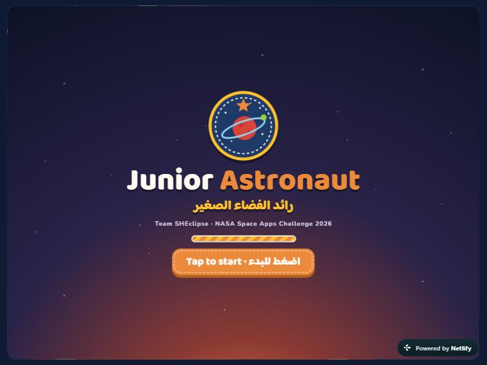
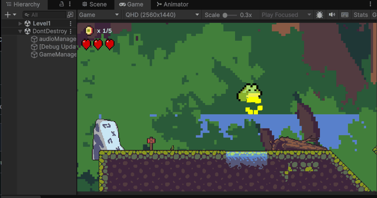
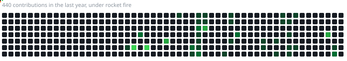
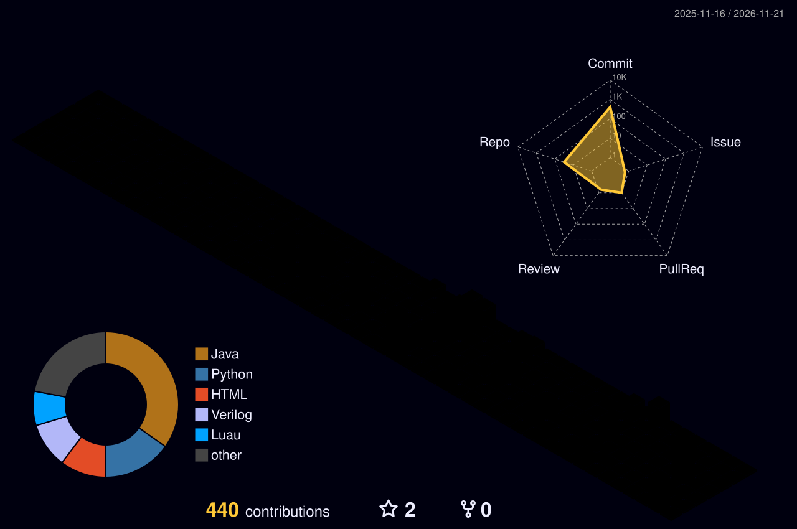
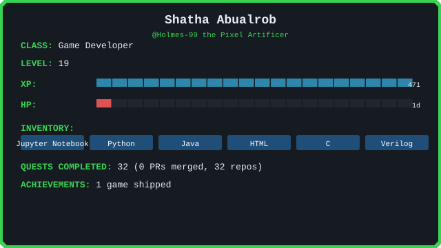

<!-- Layout based on the free "Everything Hub" template from GitSkins (https://www.gitskins.com/templates).
     Pixel portrait: assets/pixel/pixel-me.svg, generated by scripts/pixel-me.py. -->

<!-- SECTION: header -->
<table align="center">
<tr>
<td width="240" align="center" valign="middle">

</td>
<td valign="middle">
<code>PLAYER 1 · HOLMES-99</code>
<h1>Shatha Abualrob</h1>
شذى أبو الرب  
<b>Backend Intern at ASAL Technologies · Aspiring Game Developer</b> 
4th-year Computer Engineering student at Birzeit University, Palestine 🇵🇸
  

 

</td>
</tr>
</table>

  

<!-- /SECTION: header -->

<!-- SECTION: about -->

<b>👩‍💻 About me</b>

 

I'm a 4th-year Computer Engineering student at **Birzeit University** and a backend intern at **ASAL Technologies** in Rawabi.
I make games, from 2D platformers in **Unity & C#** to a full Roblox game in **Luau**, and I like low-level work just as much: raw socket servers, a pipelined RISC processor in Verilog, an ESP32 maze-solving robot, and cryptography written from scratch.

- 💼 Backend intern at **ASAL Technologies**, Rawabi
- 🤖 In the **FlyRank ML internship**, working on search ranking with real search data
- 🧪 Built and released **Grow a Brainrot**, a creature-collecting game on Roblox
- 🩻 Built a free, offline **DICOM viewer** that doctors I know use day to day
- 🌱 Currently learning **Blender** and going deeper into **Luau**

<!-- /SECTION: about -->

<!-- SECTION: featured-builds -->

<b>🎮 Featured builds</b>

 

<table>
<tr>
<td width="50%" valign="top" align="center">

 <b>🧪 <a href="https://github.com/Holmes-99/GrowABrainrot">Grow a Brainrot</a></b> · <a href="https://www.roblox.com/games/109448329924596">play on Roblox</a>
 A creature-collecting Roblox game in Luau: brew potions, grow creatures from mixed-up body parts, battle in the Colosseum, bet and trade.
</td>
<td width="50%" valign="top" align="center">

 <b>🧑‍🚀 <a href="https://github.com/Holmes-99/lunar-night-shift">Junior Astronaut</a></b> · <a href="https://junior-astronaut-sheclipse.netlify.app/junior-astronaut/">play in browser</a>
 A 3D educational game in Three.js that trains kids 7 to 12 to think like astronauts, using real NASA data. Team SHEclipse, NASA Space Apps Challenge 2026.
</td>
</tr>
<tr>
<td width="50%" valign="top" align="center">

 <b>🐭 <a href="https://github.com/Holmes-99/maze-solver-micromouse">Toots, Micromouse Robot</a></b> · team project
 An ESP32 robot that maps an 8×8 maze and races the shortest path: floodfill, PID motor control and time-of-flight sensors.
</td>
<td width="50%" valign="top" align="center">

 <b>🔐 <a href="https://github.com/Holmes-99/SecureVault">SecureVault</a></b>
 End-to-end encrypted file sharing over an untrusted server. AES-256-GCM, X25519, Ed25519 and HKDF from scratch, with a live MITM attack demo.
</td>
</tr>
<tr>
<td width="50%" valign="top" align="center">

 <b>🐸 <a href="https://github.com/Holmes-99/FrogHopFlyHunt">Frog Hop: Fly Hunt</a></b> · <a href="https://holmes-99.itch.io/frog-hop-fly-hunt">play on itch.io</a>
 A 2D swamp platformer in Unity 6: hop, dodge water and hunt flies.
</td>
<td width="50%" valign="top" align="center">
 <b>🩻 <a href="https://github.com/Holmes-99/dicom-viewer">DICOM Viewer</a></b>
 A free, offline desktop viewer for CT, MR, X-ray, ultrasound and PET images. I built it for my father and brother, and now they and their colleagues use it.
  
<b>🤖 <a href="https://github.com/Holmes-99/flyrank-ml-internship">FlyRank ML Internship</a></b>
 Search ranking and discoverability on anonymized real search data. Ongoing.
</td>
</tr>
</table>

<!-- /SECTION: featured-builds -->

<!-- SECTION: rocket-graph -->
<h3 align="center">🚀 My year, under rocket fire</h3>

<picture>
  <source media="(prefers-color-scheme: dark)" srcset="https://raw.githubusercontent.com/Holmes-99/Holmes-99/output/rocket-dark.svg" />
  <source media="(prefers-color-scheme: light)" srcset="https://raw.githubusercontent.com/Holmes-99/Holmes-99/output/rocket-light.svg" />
  
</picture>
<!-- /SECTION: rocket-graph -->

<!-- SECTION: 3d-contrib -->
<h3 align="center">🏙️ The city I built this year</h3>

Every building is a day; taller means more commits.

<!-- /SECTION: 3d-contrib -->

<!-- SECTION: snake -->
<h3 align="center">🐍 Contribution snake</h3>

<picture>
  <source media="(prefers-color-scheme: dark)" srcset="https://raw.githubusercontent.com/Holmes-99/Holmes-99/output/github-contribution-grid-snake-dark.svg" />
  <source media="(prefers-color-scheme: light)" srcset="https://raw.githubusercontent.com/Holmes-99/Holmes-99/output/github-contribution-grid-snake.svg" />
  
</picture>
<!-- /SECTION: snake -->

<!-- SECTION: skills -->

<b>🧰 Stack</b>

 

  

<table align="center">
<tr>
<td align="right"><b>Languages</b></td>
<td>

</td>
</tr>
<tr>
<td align="right"><b>Games & 3D</b></td>
<td>

</td>
</tr>
<tr>
<td align="right"><b>Backend & apps</b></td>
<td>

</td>
</tr>
<tr>
<td align="right"><b>ML & data</b></td>
<td>

</td>
</tr>
<tr>
<td align="right"><b>Hardware</b></td>
<td>

</td>
</tr>
<tr>
<td align="right"><b>Tools</b></td>
<td>

</td>
</tr>
</table>

<!-- /SECTION: skills -->

<!-- SECTION: more-projects -->

<b>🗂️ More projects</b>

 

**Machine learning**
- [Neural network](https://github.com/Holmes-99/ml-neural-network) · [Random forest](https://github.com/Holmes-99/ml-random-forest) · [K-Means](https://github.com/Holmes-99/ml-kmeans-clustering) · [Decision tree](https://github.com/Holmes-99/ml-decision-tree) · [KNN](https://github.com/Holmes-99/ml-knn-classifier) · [Data preprocessing](https://github.com/Holmes-99/ml-data-preprocessing)
- [PlayTennis + Breast Cancer classification](https://github.com/Holmes-99/ml-classification-playtennis-cancer): Decision Tree and Naive Bayes
- [Hospital Location Optimizer](https://github.com/Holmes-99/hospital-location-optimizer): Hill Climbing and Simulated Annealing

**Systems, networking and hardware**
- [Pipelined RISC processor](https://github.com/Holmes-99/pipelined-risc-processor-verilog): 5-stage, 32-bit, predicated, in Verilog
- [32-bit RISC processor in Logisim](https://github.com/Holmes-99/32bit-risc-processor-logisim): single-cycle, custom ISA
- [Multiplayer quiz game](https://github.com/Holmes-99/multiplayer-quiz-game-python): raw TCP + UDP, no libraries
- [HTTP web server](https://github.com/Holmes-99/http-webserver-python): raw sockets, bilingual Arabic/English pages
- [Palestine road network MST](https://github.com/Holmes-99/palestine-road-network-mst-c): Kruskal vs Prim in C

**Apps**
- [HealthPlus](https://github.com/Holmes-99/HealthPlus): JavaFX warehouse system for a pharma distributor, 15 entities, role-based login
- [Travel Planner](https://github.com/Holmes-99/travel-planner-android-app): Android app with a Spring Boot + MySQL backend

<!-- /SECTION: more-projects -->

<!-- SECTION: github-stats -->

<b>📊 By the numbers</b>

 

  

<picture>
  <source media="(prefers-color-scheme: dark)" srcset="https://raw.githubusercontent.com/Holmes-99/Holmes-99/output/rpg-sheet-dark.svg" />
  <source media="(prefers-color-scheme: light)" srcset="https://raw.githubusercontent.com/Holmes-99/Holmes-99/output/rpg-sheet-light.svg" />
  
</picture>

<!-- /SECTION: github-stats -->

<!-- SECTION: activity -->

<b>📰 Recent activity</b>

 

<!-- DEVLOG:START -->
- [Holmes-99 pushed dicom-viewer](https://github.com/Holmes-99/dicom-viewer/compare/d915691a54...3e636d1802)
- [Holmes-99 pushed dicom-viewer](https://github.com/Holmes-99/dicom-viewer/compare/bdffd4fd6f...5698461d42)
- [Holmes-99 pushed dicom-viewer](https://github.com/Holmes-99/dicom-viewer/compare/f71a3ab792...37a3a176cc)
- [Holmes-99 made this repository public](https://github.com/Holmes-99/dicom-viewer)
- [Holmes-99 pushed lunar-night-shift](https://github.com/Holmes-99/lunar-night-shift/compare/6044584439...c192bf39da)
<!-- DEVLOG:END -->

<!-- /SECTION: activity -->

<!-- SECTION: guestbook -->

<b>📔 Guestbook</b>

 

<a href="https://github.com/Holmes-99/Holmes-99/issues/new?template=guestbook.yml">Sign the guestbook</a>, your note shows up here.

<!-- GUESTBOOK:START -->
_No signatures yet, be the first!_
<!-- GUESTBOOK:END -->

<!-- /SECTION: guestbook -->

Shatha Abualrob · pixel portrait drawn in code · layout from <a href="https://www.gitskins.com/readme-generator">GitSkins</a>

